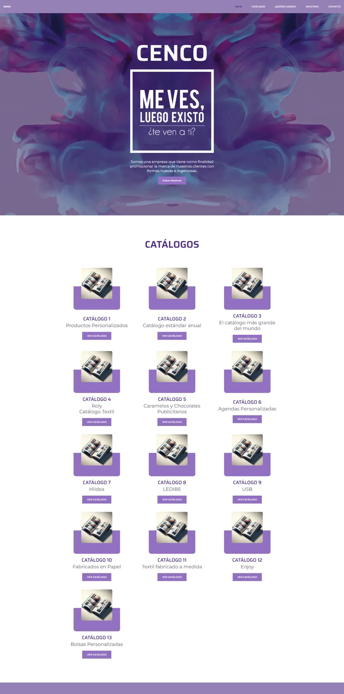
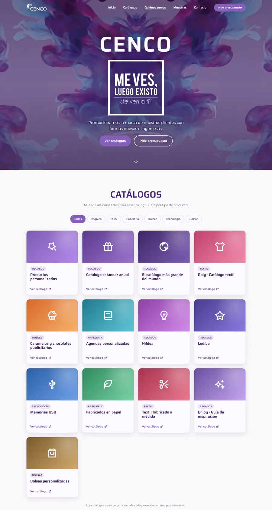
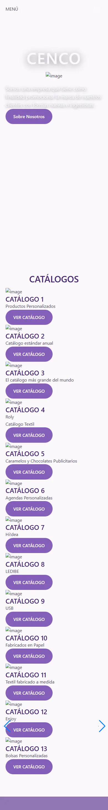
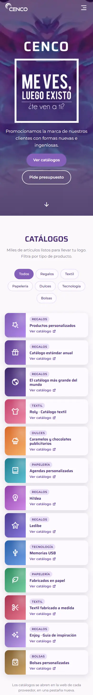

# Cenco · Website

Website for **Cenco**, a promotional products and corporate merchandising company in
La Laguna (Tenerife). Built with plain **HTML, CSS and JavaScript**, with no frameworks
and no build step, and published on GitHub Pages.

🌐 **Live:** https://sprombash.github.io/Cenco-Website/

> Real client project, published with the company's permission.

## Before / after

| | Before | After |
|---|---|---|
| **Desktop** |  |  |
| **Mobile** |  |  |

## Features

- **Catalogue browser**: 13 supplier catalogues with category filters
  (gifts, textile, stationery, sweets, tech, bags) and a generated cover for each one.
- **Sample gallery** with an accessible lightbox (native `<dialog>`, keyboard
  arrows, focus restored on close).
- **Quote request form** with inline validation. It sends nothing to a server: it opens
  WhatsApp with the message already written, so it works on static hosting and stores no data.
- **Contact**: click-to-call phones, a floating WhatsApp button and a live
  *open now / closed now* badge computed in the Canary Islands time zone.
- **Privacy-friendly map**: Google Maps only loads (and sets cookies) when the visitor asks for it.
- **Legal pages**: legal notice and privacy & cookies policy (LSSI-CE / GDPR).

## What I improved in the redesign

| Area | Before | After |
|---|---|---|
| **Bugs** | A leftover template CSS set `html { font-size: 62.5% }`, shrinking every `rem` on the site; the email button opened a draft in the developer's own Gmail; the newsletter form did nothing | Clean, mobile-first CSS rewrite; every contact action works for every visitor |
| **Performance** | ~4 MB of PNG/JPEG, Swiper + ScrollReveal + Ionicons | **~260 KB** of WebP with lazy loading and responsive hero images, **zero JS dependencies** |
| **Accessibility** | `alt="image"`, `div` as menu button, hidden focus outline, long animations that replayed on every scroll | Descriptive alt text, real `<button>`s with `aria-expanded` / `aria-pressed`, visible focus, skip link, `prefers-reduced-motion` respected, animations play once |
| **SEO** | No meta description, favicon or social preview | Meta description, Open Graph / Twitter cards, favicon, `LocalBusiness` structured data |
| **Content** | Fake "4.5 ★" ratings and template leftovers; only 7 of 12 samples shown | Real product names, all 12 samples, clear calls to action |

## Testing

Interaction tests run in headless Edge against the real page: mobile menu, filters,
lightbox navigation, form validation and the generated WhatsApp message, opening-hours
badge, on-demand map, no horizontal overflow at 390 px, no broken images and no JS errors.

## Structure

```
index.html            # single page: home, catalogues, about, samples, quote, contact
aviso-legal.html      # legal notice
privacidad.html       # privacy & cookies
assets/
├── css/styles.css    # mobile-first styles, CSS custom properties
├── css/legal.css
├── js/main.js        # menu, filters, lightbox, form → WhatsApp, map, reveal
└── img/              # optimised WebP images, favicon, Open Graph image
```

## Run locally

No build needed: open `index.html` in a browser, or serve the folder:

```bash
python -m http.server 8000
```
